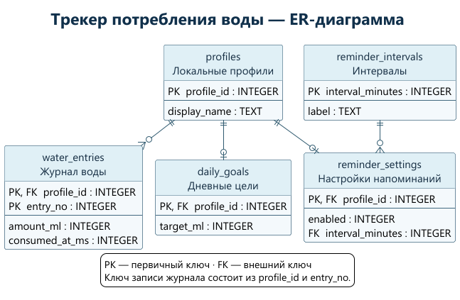

# Проектирование базы данных трекера потребления воды

Лабораторная работа №4, вариант 24. Исполнитель — [@mpleteneva33-lab](https://github.com/mpleteneva33-lab).

## 1. Что хранится в базе

В трекере записываются объём выпитой воды и время записи. Профиль объединяет записи, текущую дневную цель и настройки напоминаний. Локальный профиль обозначает отдельный журнал в учебной модели. Для работы браузерного приложения регистрация не нужна.

| Данные | Правила из технического задания |
| --- | --- |
| Запись воды | Целое число от 1 до 2 000 мл и время с устройства. Запись можно удалить отдельно. |
| Дневная цель | Необязательное целое число от 1 до 10 000 мл. Одна текущая цель действует каждый день до изменения. |
| Напоминания | Интервалы 30, 60 или 120 минут. Начальное состояние выключено, выбранный интервал составляет 60 минут. |
| Дневная сводка | Сумма и процент вычисляются из записей за день. При превышении цели процент может быть больше 100. |

[Техническое задание](https://github.com/mpleteneva33-lab/smart-todo-srs-/wiki/Техническое-задание) · [Задача анализа #35](https://github.com/mpleteneva33-lab/smart-todo-srs-/issues/35)

## 2. Исходная структура

Если хранить профиль, настройки и весь журнал в одной строке, получится следующая запись.

```text
Journal_Flat(
  profile_id, display_name,
  entries = [{entry_no, amount_ml, consumed_at_ms}, …],
  target_ml, enabled, interval_minutes, interval_label
)
```

Список записей в одной ячейке усложняет выборку за день, проверку объёмов и удаление одной порции. После разворачивания списка в строки начинают повторяться имя, цель и настройки. Изменение цели потребует обновления всех строк профиля. Добавить цель до первой записи невозможно в структуре, где строку определяет запись воды. Удаление последней записи может удалить единственную копию цели и настроек.

## 3. Первая нормальная форма (1НФ)

Каждая порция становится отдельной строкой. В ячейках остаются атомарные значения, например `250` в столбце `amount_ml`. Номер порции локален для профиля, поэтому ключ строки составляют `(profile_id, entry_no)`.

```text
Journal_1NF(
  profile_id, entry_no, amount_ml, consumed_at_ms,
  display_name, target_ml, enabled, interval_minutes, interval_label
)
```

## 4. Вторая нормальная форма (2НФ)

Объём и время определяются парой `(profile_id, entry_no)`. Имя, цель и настройки зависят только от `profile_id`, то есть от части составного ключа. Выносим эти данные в промежуточную таблицу `Profile_2NF` с ключом `profile_id`.

```text
water_entries(profile_id, entry_no, amount_ml, consumed_at_ms)
Profile_2NF(profile_id, display_name, target_ml, enabled, interval_minutes, interval_label)
```

Теперь удалить последнюю запись можно без потери профиля. У профиля можно указать цель до появления первой записи.

## 5. Третья нормальная форма (3НФ)

В промежуточной таблице остаётся зависимость `profile_id → interval_minutes → interval_label`. Например, подпись «30 минут» определяется интервалом и дублируется у всех выбравших его профилей. Выносим подписи в `reminder_intervals`. В настройках остаётся ссылка на интервал.

Необязательные цель и настройки получают отдельные таблицы со связью по `profile_id`. Дневной итог и процент вычисляются при чтении. Получаются следующие функциональные зависимости.

| Таблица | Ключ | Зависимые поля |
| --- | --- | --- |
| `profiles` | `profile_id` | `display_name` |
| `water_entries` | `profile_id, entry_no` | `amount_ml, consumed_at_ms` |
| `daily_goals` | `profile_id` | `target_ml` |
| `reminder_settings` | `profile_id` | `enabled, interval_minutes` |
| `reminder_intervals` | `interval_minutes` | `label` |

У каждой зависимости в итоговой схеме определитель является ключом своей таблицы. Неключевые поля зависят от всего ключа и не образуют транзитивных зависимостей.

## 6. ER-диаграмма и связи



- У профиля может быть от нуля до многих записей. Каждая запись принадлежит одному профилю.
- У профиля может быть ноль или одна текущая цель и ноль или одна запись настроек. Их `profile_id` одновременно первичный и внешний ключ.
- Один интервал может использоваться в настройках многих профилей. В каждой записи настроек выбран ровно один интервал. Если записи настроек нет, действуют значение «выключено» и 60 минут.
- Текущие сценарии используют связи 1:N и 1:0..1. Оснований для связующей таблицы M:N в техническом задании нет.

[PNG](../docs/database/er_diagram.png) · [SVG](../docs/database/er_diagram.svg) · [Исходник PlantUML](../docs/database/er_diagram.puml)

## 7. Ограничения, время и индексы

Схема рассчитана на SQLite 3.37 и новее. Типизация `STRICT` и `CHECK` проверяют объём воды, цель, интервал и флаг напоминаний. Внешние ключи предотвращают появление строк без профиля или допустимого интервала. Каскадное удаление профиля удаляет принадлежащие ему записи, цель и настройки. Включайте `PRAGMA foreign_keys = ON` в каждом новом соединении.

Время порции хранится в миллисекундах Unix. Для локального дня приложение передаёт UTC-границы двух соседних полуночей. Условие включает начало дня и исключает начало следующего, в том числе в часовых поясах с изменением смещения.

Индекс `idx_water_entries_profile_time` ускоряет выборку по профилю и диапазону времени и обеспечивает порядок от новых записей к старым. Индекс `idx_reminder_settings_interval` поддерживает поиск настроек по интервалу.

## 8. Запуск и проверка

На пустой базе выполните [schema.sql](schema.sql), затем один раз [seed_data.sql](seed_data.sql). Схема создаёт справочник из трёх интервалов, а тестовые данные добавляют два профиля, пять записей, одну цель и одну настройку напоминаний.

```sh
sqlite3 tracker.db ".bail on" ".read database/schema.sql" ".read database/seed_data.sql" "PRAGMA foreign_key_check;"
```

Пустой результат `foreign_key_check` означает отсутствие нарушений. В тестовых данных для профиля 1 за 27 ноября 2026 года в UTC+03:00 видны записи на 250 и 500 мл. Итог составляет 750 мл, цель — 2 000 мл, прогресс — 38%. Записи соседних дней и второго профиля в итог не входят.

Запрос списка за день.

```sql
SELECT entry_no, amount_ml, consumed_at_ms
FROM water_entries
WHERE profile_id = :profile_id
  AND consumed_at_ms >= :day_start_ms
  AND consumed_at_ms < :next_day_start_ms
ORDER BY consumed_at_ms DESC, entry_no DESC;
```

Запрос сводки с вычислением процента и проверкой достижения цели.

```sql
WITH daily_total AS (
    SELECT COALESCE(SUM(amount_ml), 0) AS total_ml
    FROM water_entries
    WHERE profile_id = :profile_id
      AND consumed_at_ms >= :day_start_ms
      AND consumed_at_ms < :next_day_start_ms
)
SELECT
    daily_total.total_ml,
    daily_goals.target_ml,
    CAST(ROUND(100.0 * daily_total.total_ml / daily_goals.target_ml) AS INTEGER) AS percent,
    daily_total.total_ml >= daily_goals.target_ml AS goal_reached
FROM profiles
CROSS JOIN daily_total
LEFT JOIN daily_goals USING (profile_id)
WHERE profiles.profile_id = :profile_id;
```

Запустите автоматические тесты из корня репозитория.

```sh
python tests/test_database.py
```

Восемь тестов проверяют загрузку данных, границы дня, прогресс свыше 100%, ограничения, ключи, значения по умолчанию, каскадное удаление и использование индекса. Проверки SQLite также запускает GitHub Actions.

Схема SQLite относится к лабораторной №4. Браузерный трекер из лабораторной №3 продолжает сохранять данные в `localStorage`.
