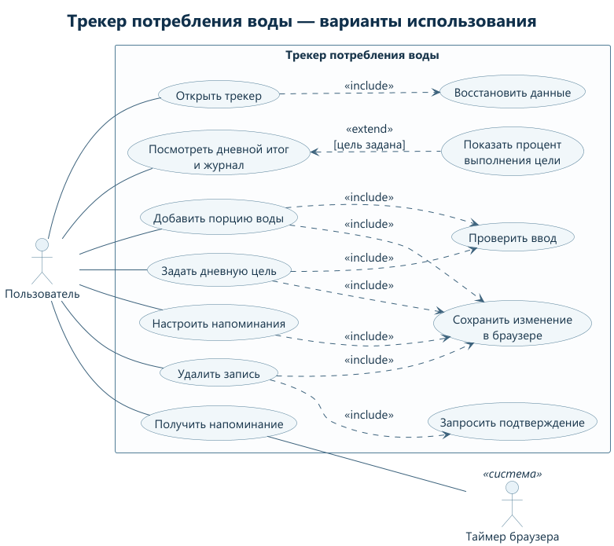

# Моделирование поведения трекера потребления воды

Лабораторная работа №5, вариант 24. Исполнитель — [@mpleteneva33-lab](https://github.com/mpleteneva33-lab).

**Use Case** показывает действия, доступные пользователю. **Диаграммы последовательности** показывают, какие компоненты выполняют эти действия и в каком порядке. Сценарии основаны на техническом задании и текущем коде браузерного трекера. [Техническое задание](https://github.com/mpleteneva33-lab/smart-todo-srs-/wiki/Техническое-задание) · [Описание приложения](../development-process.md)

## Use Case



Пользователь открывает трекер, смотрит записи и дневной итог, добавляет воду, задаёт цель, удаляет записи и настраивает напоминания. Таймер браузера инициирует срабатывание напоминания. Он показан за границей системы, а логика выбора интервала находится в трекере.

- `<<include>>` показывает общий шаг сценария. Например, при вводе воды или цели проверяется значение, а подтверждённое изменение передаётся на сохранение. Варианты ошибки, отмены и отказа хранилища раскрыты в диаграммах последовательности.
- `<<extend>>` показывает дополнительное действие при условии. Процент выполнения показывается вместе с дневным итогом, если пользователь задал цель. [PNG](../use_case/use_case_diagram.png) · [SVG](../use_case/use_case_diagram.svg) · [PlantUML](../use_case/use_case_diagram.puml)

## Диаграммы последовательности

| Сценарий | PNG | SVG | Исходник |
| --- | --- | --- | --- |
| Добавление порции воды | [PNG](sequence/add_water_sequence.png) | [SVG](sequence/add_water_sequence.svg) | [PlantUML](sequence/add_water_sequence.puml) |
| Удаление с подтверждением | [PNG](sequence/delete_water_sequence.png) | [SVG](sequence/delete_water_sequence.svg) | [PlantUML](sequence/delete_water_sequence.puml) |
| Настройка и срабатывание напоминаний | [PNG](sequence/reminder_sequence.png) | [SVG](sequence/reminder_sequence.svg) | [PlantUML](sequence/reminder_sequence.puml) |
| Полный дневной сценарий | [PNG](sequence/daily_workflow_sequence.png) | [SVG](sequence/daily_workflow_sequence.svg) | [PlantUML](sequence/daily_workflow_sequence.puml) |

Диаграммы читаются сверху вниз. `alt` обозначает альтернативные ветки, `opt` — шаг, который выполняется при условии, `loop` — повторение, `ref` — ссылку на другую последовательность или её фрагмент.

### 1. Добавление порции воды

Пользователь нажимает «Добавить». `script.js` передаёт введённый объём в `parseAmount`. Объём должен быть целым числом от 1 до 2 000 мл. После успешной проверки модель создаёт запись с временем устройства. Обработчик обновляет состояние в памяти, записывает его в `localStorage` и пересчитывает сводку. При ошибке ввода запись не создаётся. При сбое хранения показано сообщение «Не удалось сохранить данные», а состояние остаётся доступным на открытой странице. [Диаграмма добавления](sequence/add_water_sequence.svg) · [Issue №1](https://github.com/mpleteneva33-lab/smart-todo-srs-/issues/1)

### 2. Удаление с подтверждением

При нажатии «Удалить» открывается диалог с объёмом и временем выбранной записи. После подтверждения модель удаляет её, если запись относится к текущему дню. Приложение сохраняет изменённый журнал и пересчитывает сумму и прогресс. «Отмена» и Esc оставляют записи без изменений. Диаграмма также показывает ошибку записи в хранилище. [Диаграмма удаления](sequence/delete_water_sequence.svg) · [Issue №4](https://github.com/mpleteneva33-lab/smart-todo-srs-/issues/4)

### 3. Настройка и срабатывание напоминаний

Пользователь меняет переключатель или выбирает 30, 60 или 120 минут. Настройки сохраняются, а модель сравнивает новый активный интервал с прежним. При изменении интервала старый вызов отменяется, при включённом переключателе планируется новый. По истечении интервала планируется следующее срабатывание, а сообщение появляется в видимой вкладке, если предыдущий баннер закрыт. Добавление воды сохраняет журнал и оставляет текущий отсчёт. [Диаграмма напоминаний](sequence/reminder_sequence.svg) · [Issue №5](https://github.com/mpleteneva33-lab/smart-todo-srs-/issues/5)

### 4. Полный дневной сценарий

При открытии страницы трекер читает `localStorage`, загружает настройки, показывает дневной итог и восстанавливает напоминания. При ошибке чтения отображается отдельное сообщение. Пользователь может задать цель от 1 до 10 000 мл, добавлять порции и исправлять журнал. При смене локальной даты трекер выбирает записи нового дня и заново рассчитывает прогресс по сохранённой цели. [Диаграмма дня](sequence/daily_workflow_sequence.svg) · [Issue №2](https://github.com/mpleteneva33-lab/smart-todo-srs-/issues/2) · [Issue №3](https://github.com/mpleteneva33-lab/smart-todo-srs-/issues/3) · [Issue №6](https://github.com/mpleteneva33-lab/smart-todo-srs-/issues/6)

## Компоненты трекера

- [`index.html`](../../index.html) — формы, дневная сводка, диалог удаления и сообщение-напоминание.
- [`script.js`](../../script.js) — действия пользователя, сохранение состояния и обновление страницы.
- [`model.js`](../../model.js) — валидация, операции с журналом, расчёты, чтение и запись данных, логика таймера.
- `localStorage` — браузерное хранилище журнала и настроек. SQLite из лабораторной №4 используется как отдельная учебная модель. [Схема базы](../../database/normalization.md)

## Как пересобрать диаграммы

Из корня репозитория запустите PlantUML с кодировкой UTF-8. Укажите путь к своему `plantuml.jar`, если он находится вне репозитория.

```sh
java -jar plantuml.jar -charset UTF-8 -failfast2 -checkonly "docs/use_case/*.puml" "docs/behavior/sequence/*.puml"
java -jar plantuml.jar -charset UTF-8 -failfast2 -tpng "docs/use_case/*.puml" "docs/behavior/sequence/*.puml"
java -jar plantuml.jar -charset UTF-8 -failfast2 -tsvg "docs/use_case/*.puml" "docs/behavior/sequence/*.puml"
```

Для быстрой проверки сценария добавления можно задать цель 2 000 мл, внести 250 и 500 мл и увидеть 750 мл и 38%. Отмена удаления оставляет сводку прежней. После подтверждения удаления 250 мл остаётся 500 мл и 25%. [Запуск приложения](../../README.md#как-запустить)
