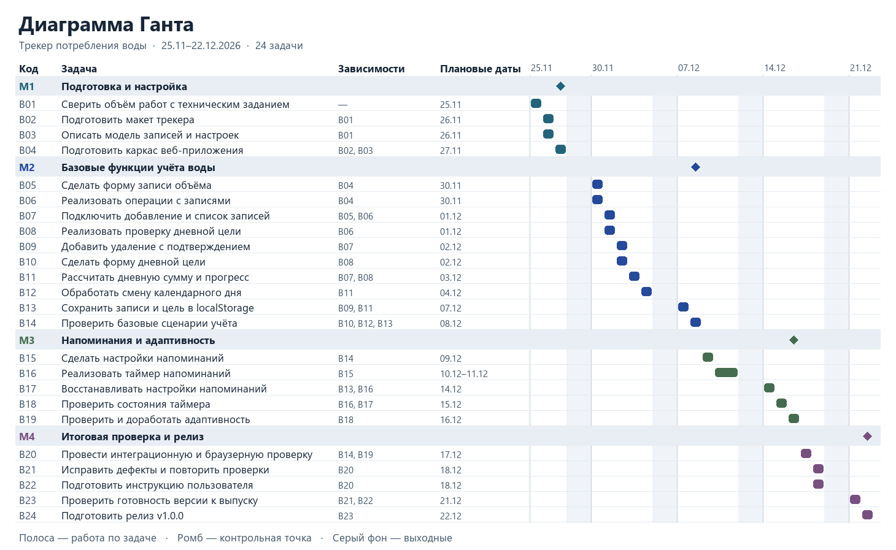

# План проекта

Лабораторная работа № 2 «Планирование проекта и управление командой».
Проект **«Трекер потребления воды»**, вариант 24.

План описывает разработку веб-приложения с учётом выпитой воды, дневной целью и напоминаниями. В основу положены [техническое задание](https://github.com/mpleteneva33-lab/smart-todo-srs-/wiki/Техническое-задание) и шесть исходных [Issues](https://github.com/mpleteneva33-lab/smart-todo-srs-/issues).

## Участники и роли

Один исполнитель **@mpleteneva33-lab** выполняет все пять ролей. В каждой задаче указана одна основная роль.

| Роль | Исполнитель | Обязанности |
| --- | --- | --- |
| Менеджер проекта | @mpleteneva33-lab | Ведёт беклог, следит за сроками, готовит инструкцию и релиз. |
| Дизайнер | @mpleteneva33-lab | Проектирует экран, форму ввода, настройки и состояния интерфейса. |
| Frontend-разработчик | @mpleteneva33-lab | Собирает веб-интерфейс, формы, диалоги и адаптивную вёрстку. |
| Разработчик прикладной логики | @mpleteneva33-lab | Реализует расчёты, модель данных, localStorage и таймер. Приложение работает в браузере. |
| QA-инженер | @mpleteneva33-lab | Готовит сценарии, проверяет границы, браузеры, таймер и готовность к выпуску. |

## Беклог и контрольные точки

| Этап | Задачи | Срок | Результат |
| --- | --- | --- | --- |
| M1 Подготовка и настройка | B01–B04 | 27.11.2026 | Согласованы объём работ, макет и модель данных. Подготовлен каркас веб-приложения. |
| M2 Базовые функции учёта воды | B05–B14 | 08.12.2026 | Проверены журнал, дневная цель, прогресс, удаление и восстановление данных. |
| M3 Напоминания и адаптивность | B15–B19 | 16.12.2026 | Проверены интервалы и восстановление настроек. Интерфейс пригоден для экрана шириной 360 px. |
| M4 Итоговая проверка и релиз | B20–B24 | 22.12.2026 | Выполнена проверка в целевых браузерах, подготовлена документация и выпущена версия v1.0.0. |

P0 — подготовка, базовые функции и контроль качества. P1 — напоминания, адаптивность и подготовка выпуска. В рамках этапа порядок задают зависимости между задачами.

## Календарный план

- [Диаграмма Ганта в GitHub Projects](https://github.com/users/mpleteneva33-lab/projects/1/views/2)
- [Беклог и даты в GitHub Projects](https://github.com/users/mpleteneva33-lab/projects/1/views/1)
- [План проекта в Wiki](https://github.com/mpleteneva33-lab/smart-todo-srs-/wiki/План-проекта)

В календарном плане для всех задач указаны начало, окончание и коды предшественников. Задача начинается после завершения всех указанных предшественников.

- [Подробный беклог](backlog.md)
- [Календарный план в CSV](schedule.csv)

## Ключевые метрики

- 24 задачи. Низкая сложность — 8, средняя — 13, высокая — 3.
- Период **25.11–22.12.2026**. Продолжительность — 28 календарных дней, из них 20 будних.
- Всего **84 ч**. Оценки относятся к работе одного исполнителя и включают проверку и подготовку релиза.

Оформление по образцу [плана проекта «Планировщик уборки»](https://github.com/darazalilova-cpu/cleaning-planner-srs/wiki/План-проекта).
